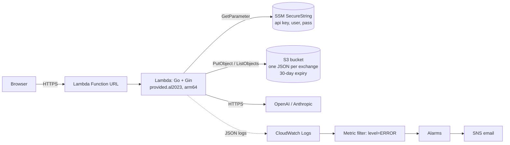
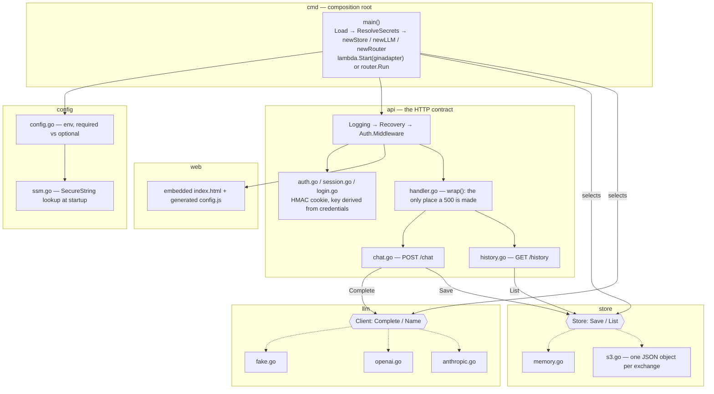

# Go Chat

A single-page chat app: Go + Gin on Lambda, an LLM provider behind a small
interface, and prompt/response history in S3. One command deploys it, one
destroys it, and it costs essentially nothing sitting idle.

## Architecture



Routes: `GET /` (embedded `index.html`), `GET /config.js`, `POST /chat`,
`GET /history`, `GET /healthz`, `POST /login`, `GET /logout`. Everything
except `/login` requires a signed session cookie.

## Code layout

`cmd/main.go` is the entrypoint.loads config, resolves secrets, picks a store and a provider behind two
interfaces, and then starts either the Lambda runtime or a local HTTP server.
Everything below it depends on the interfaces, not the implementations.



## Prerequisites

- AWS credentials that can assume a deployment role with permission to manage
  Lambda, S3, SSM, IAM, CloudWatch, and SNS
- Terraform >= 1.9, Go 1.27, [`just`](https://just.systems/), `zip`
- An OpenAI or Anthropic API key
- Optional: an existing S3 bucket for remote state (local state otherwise)

## Deploy

1. In `scripts/run.sh`, set `AWS_REGION`, `TF_VAR_aws_iam_role`, and either an
   existing `TF_STATE_BUCKET` or `""` for local state.
2. Create `infra/terraform.tfvars` (gitignored):

```hcl
llm_provider = "openai"
llm_model    = "gpt-4o-mini"
llm_api_key  = "YOUR_API_KEY"
```

3. Deploy, then read the URL and the generated credentials:

```sh
just tf plan
just tf apply
just tf output dev app_url
just tf output dev -raw app_user_name
just tf output dev -raw app_user_pass
```

`plan` cross-compiles the ARM64 binary and zips it; `apply` consumes the saved
plan. Sign in at the printed URL with those credentials. No manual steps after.

## Destroy

```sh
just tf destroy
```

Removes everything, including chat history (`force_destroy = true`) and the
managed SSM parameters. Nothing is left behind.

## Run locally

Copy `app/.env.example` to `app/.env.local`, keep `STORE_BACKEND=memory`, set
`APP_USER_NAME` / `APP_USER_PASS`, and pick a provider (`fake` needs no key):

```sh
just run    # http://localhost:8080
just test
```

Details: [application](app/README.md) | [infrastructure](infra/README.md).

## Decisions

| Decision | Why |
|---|---|
| Lambda + Function URL, not ECS/App Runner | Scales to zero, so idle cost is ~$0. A Function URL is managed HTTPS with no certificate, domain, ALB, or CloudFront — the cheapest way to satisfy "HTTPS, zero manual steps". |
| Go on `provided.al2023`/arm64 | One static binary, fast cold start, Graviton pricing. |
| Same binary runs locally and in Lambda | `main` switches on `AWS_LAMBDA_RUNTIME_API`: Gin's API Gateway v2 adapter in Lambda, a normal HTTP server otherwise. Local dev isn't a second code path. |
| S3, one JSON object per exchange | No table to provision, a lifecycle rule expires history at 30 days, and `force_destroy` makes teardown complete. The cost is the read path — see below. |
| SSM Parameter Store, not Secrets Manager | Standard parameters are free; Secrets Manager is $0.40/secret/month for rotation this doesn't do. Lambda receives parameter *names* and resolves them at startup — no secret values in its environment. |
| Terraform generates the login credentials | Nothing to hardcode. `random_password` → SecureString → sensitive outputs. |
| Session cookie signed with a key derived from the credentials | `index.html` is off-limits, so it can't be taught to re-authenticate on a 401. Deriving the key means no server-side session store, no second secret, and no coordination across execution environments — and rotating the password invalidates every session for free. |
| Build outside Terraform | A `plan` shouldn't require a Go toolchain, and the artifact that was reviewed is the one that ships. |
| `store` and `llm` are interfaces | `memory`/`s3` and `fake`/`openai`/`anthropic`. Tests run with no AWS account and no API key. |
| Least-privilege IAM | The execution role gets `GetParameter` on three exact ARNs, and S3 access scoped to the `exchanges/` prefix with encryption required on write. |

Honest gap: the OpenAI path is tested end to end; the Anthropic client is
implemented and unit-tested but has not been run against the real API.
This was due to a lack of an anthropic api key at the time of writing, not a design decision.

## What breaks first at 1000 users

1. **`GET /history`.** It lists the whole prefix and issues a `GetObject` per
   object on every request, then sorts in memory. At a few thousand exchanges
   that is thousands of S3 reads inside one 60-second invocation: latency
   first, timeouts shortly after. This is probably the first thing to fall over.
   *Fix: DynamoDB keyed by user with a timestamp sort key, paginated.*
2. **History is global.** One shared account means every user reads everyone
   else's conversation. A correctness bug that only appears with a second user.
   *Fix: real per-user identity and per-user partitioning.*
3. **No rate limiting.** Authentication gates access. 
   *Fix: per-session token bucket, reserved concurrency, a budget alarm. Adding a WAF rule to block the `/history` path is a cheap emergency measure.*
4. **128 MB, 60s, buffered responses.** Long generations sit near the timeout
   with the user watching a spinner. *Fix: response streaming.*

## With another week

- DynamoDB-backed, per-user, paginated history — kills failure 1 and 2 together
- Streaming responses over the Function URL
- Real authentication (Cognito or similar) instead of one shared credential
- Move compute to **ECS on Fargate with ECR** now that idle cost isn't the only
  constraint: control over the runtime and room for sidecars, starting with a
  Datadog agent. At larger scale, EKS delivered via GitOps — Argo CD with a
  Helm chart and image updater.
- CI: `plan` on merge request, `apply` on main; state bucket and lock table as
  a bootstrap stack rather than a manual prerequisite

## Time spent

Two sessions, roughly 2–3 hours each. Most of it went into designing the Go
application — the store and LLM interfaces, config loading, and the session
model. The Terraform came together quickly once those contracts were settled.
